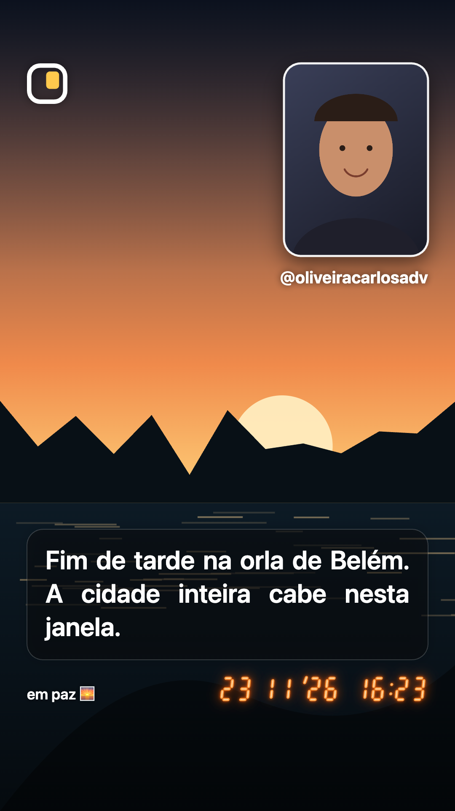
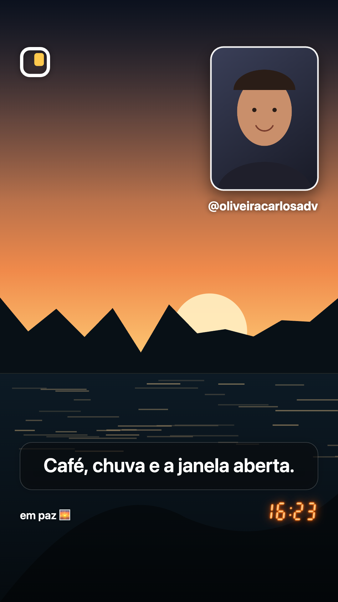
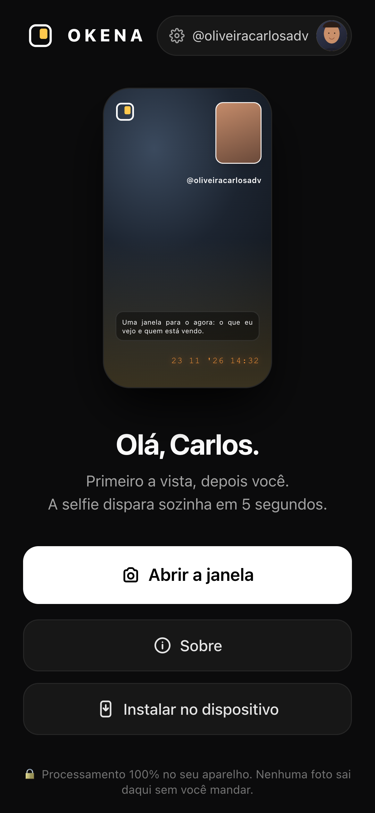
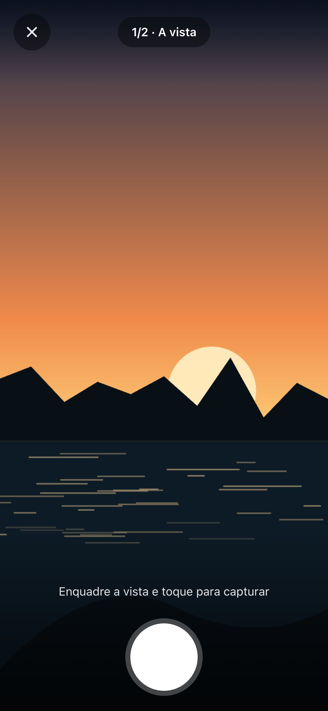
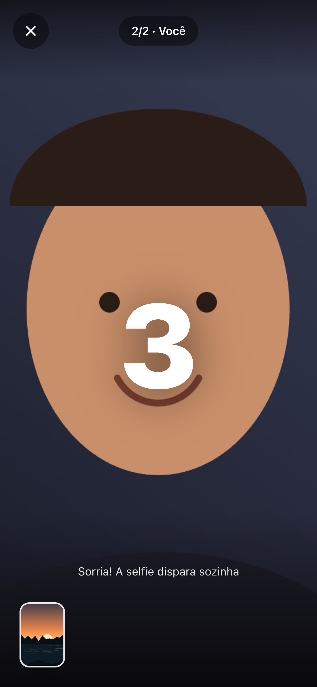
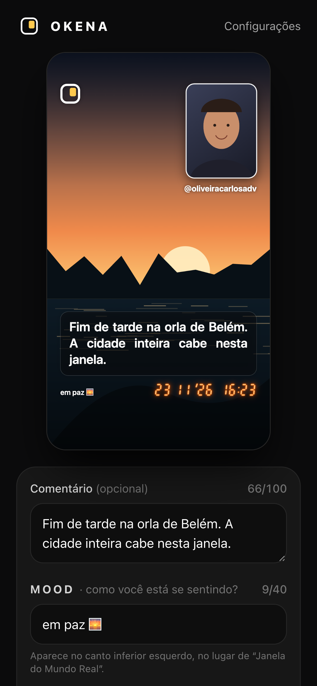
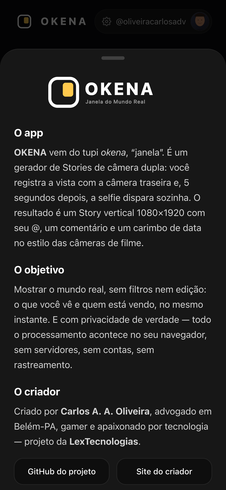
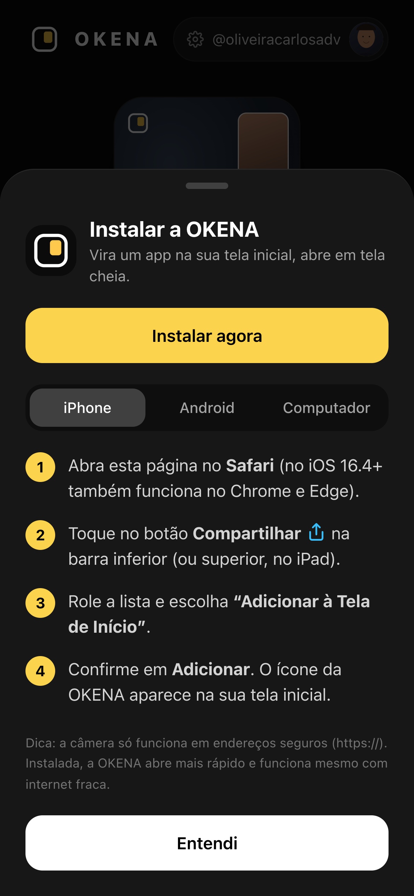

<div align="center">

<picture>
  <source media="(prefers-color-scheme: dark)" srcset="assets/logo-wordmark.svg">
  
</picture>

### A vista e a sua selfie, no mesmo instante.

**[▶︎ Abrir a OKENA](https://oliveiracarlosadv.github.io/okena/)** · [Manual de uso](docs/MANUAL-DE-USO.md) · [Documentação técnica](docs/DOCUMENTACAO-TECNICA.md) · [Privacidade](docs/PRIVACIDADE.md)


</div>

---

## O que é

**OKENA** (do tupi *okena*, “janela”) é um gerador de Stories de câmera dupla que roda inteiro no navegador.
Você fotografa a vista com a câmera traseira; a OKENA vira para a câmera frontal e, depois de uma contagem de
5 segundos, dispara a selfie sozinha. O resultado é um Story vertical **1080 × 1920** pronto para o Instagram,
o WhatsApp ou a galeria, com:

- a vista em tela cheia;
- a selfie em moldura **3:4** no canto superior direito, com borda branca e sombra;
- o seu **@** logo abaixo da selfie;
- um **comentário de até 100 caracteres**, com fonte que se ajusta ao tamanho do texto e alinhamento
  **justificado, à esquerda, centralizado ou à direita**;
- o seu **MOOD** (como você está se sentindo, até 40 caracteres) no canto inferior esquerdo;
- **data e/ou hora** no estilo do carimbo das câmeras de filme (display de LED laranja);
- o ícone da OKENA como marca d'água discreta.

<div align="center">
  
  &nbsp;&nbsp;
  
</div>

## Objetivo

Mostrar o **mundo real**, sem filtros nem pose ensaiada: o que você vê e quem está vendo, no mesmo instante.
E com privacidade de verdade: **nenhuma foto sai do seu aparelho** se você não mandar. Não há servidor, conta,
login, rastreador nem analytics. Toda a captura, composição e exportação acontece no seu navegador, com a
Canvas API.

## Telas

| Início | Vista (câmera traseira) | Selfie em 5 s | Pré-visualização |
|:-:|:-:|:-:|:-:|
|  |  |  |  |

| Cadastro | Configurações | Sobre | Instalar no dispositivo |
|:-:|:-:|:-:|:-:|
|  |  |  |  |

## Como usar (resumo)

1. Abra **https://oliveiracarlosadv.github.io/okena/** no celular.
2. Preencha nome completo e nome de usuário (a foto de perfil é opcional).
3. Toque em **Abrir a janela**, permita a câmera e capture a vista.
4. Sorria: a selfie dispara sozinha depois de 5… 4… 3… 2… 1…
5. Escreva um comentário e o seu MOOD, escolha o alinhamento, ligue ou desligue **Data** e **Hora**.
6. Toque em **Compartilhar** (Instagram, WhatsApp, Fotos…) ou **Baixar**.

O passo a passo completo, com dicas e solução de problemas, está no **[Manual de uso](docs/MANUAL-DE-USO.md)**.

## Instalar como app (PWA)

A OKENA é um Progressive Web App: dá para instalar na tela inicial e ela abre em tela cheia, como um app nativo,
e funciona offline depois da primeira visita.

- **iPhone/iPad:** Safari → botão **Compartilhar** → **Adicionar à Tela de Início**.
- **Android:** Chrome → menu **⋮** → **Instalar app**.
- **Computador:** Chrome/Edge → ícone de instalar na barra de endereço; Safari → **Arquivo › Adicionar ao Dock**.

O próprio app tem um botão **Instalar no dispositivo** com esse guia.

## Tecnologia

| | |
|---|---|
| Interface | HTML5 + [Tailwind CSS](https://tailwindcss.com) (CDN) |
| Lógica | JavaScript puro, sem frameworks nem build |
| Câmera | `navigator.mediaDevices.getUserMedia` (`environment` → `user`) |
| Composição | Canvas 2D, 1080 × 1920, PNG |
| Exportação | Web Share API (`navigator.share` com arquivo) com fallback para download |
| Dados | `localStorage` (perfil e preferências) |
| Offline | Service Worker + Web App Manifest |
| Hospedagem | GitHub Pages |

Detalhes de arquitetura, layout do Story e decisões técnicas: **[Documentação técnica](docs/DOCUMENTACAO-TECNICA.md)**.

## Rodar localmente

A câmera só funciona em **HTTPS** ou em **localhost**. Basta um servidor estático:

```bash
git clone https://github.com/oliveiracarlosadv/okena.git
cd okena
python3 -m http.server 8080
```

Abra `http://localhost:8080`. Para testar sem câmera (gera cenas de demonstração), use
`http://localhost:8080/#demo`.

## Estrutura

```
okena/
├── index.html              # o app inteiro (HTML + CSS + JS)
├── manifest.webmanifest    # PWA
├── sw.js                   # service worker (offline)
├── assets/                 # logo, ícones, favicon, imagem social
└── docs/                   # manual, documentação técnica, privacidade, prints
```

## Sobre o criador


**Carlos A. A. Oliveira** é advogado em Belém-PA, gamer e apaixonado por tecnologia. A OKENA é um projeto da
**LexTecnologias**, a frente de sistemas do escritório.

[GitHub](https://github.com/oliveiracarlosadv) · [Site](http://www.oliveiracarlos.adv.br)

<br clear="left">

## Licença

[MIT](LICENSE) © 2026 Carlos A. A. Oliveira. Use, estude, modifique e compartilhe.
