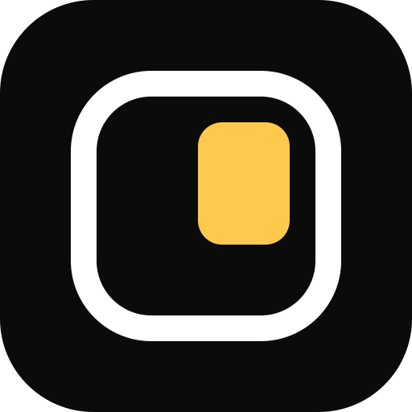

# Identidade visual — OKENA

## Conceito

**OKENA** = “janela” em tupi. O símbolo é uma **janela** (moldura branca de cantos arredondados) com uma
**selfie 3:4** âmbar no canto superior direito: a mesma composição do Story, com o mundo ao fundo e você no
canto. Slogan: **Janela do Mundo Real**.

## Cores

| Nome | Hex | Uso |
|---|---|---|
| Tinta | `#0B0B0C` | Fundo do app e do ícone |
| Branco | `#FFFFFF` | Moldura, textos principais |
| Âmbar | `#FFC94D` | Selfie do símbolo, destaques, botões ativos |
| LED retrô | `#FF9A3C` | Carimbo de data/hora |
| Neutro | `#A3A3A3` / `#525252` | Textos secundários (fundo escuro / claro) |

## Tipografia

Fonte do sistema (SF Pro no Apple, Segoe UI no Windows, Roboto no Android). O nome **OKENA** é sempre em
caixa alta, peso 800, com espaçamento largo entre letras.

## Arquivos

| Arquivo | Quando usar |
|---|---|
| `assets/logo.svg` | Ícone do app, avatar, redes sociais |
| `assets/logo-mark.svg` | Símbolo sobre fotos ou fundos escuros (sem fundo) |
| `assets/logo-wordmark.svg` | Símbolo + nome + slogan sobre fundo escuro |
| `assets/logo-wordmark-light.svg` | Símbolo + nome + slogan sobre fundo claro |
| `assets/favicon.svg` | Favicon |
| `assets/icon-maskable.svg` | Ícone Android adaptativo (área segura de 80 %) |

## No Story

O Story leva **apenas o símbolo** (sem o nome escrito), no canto superior esquerdo.
