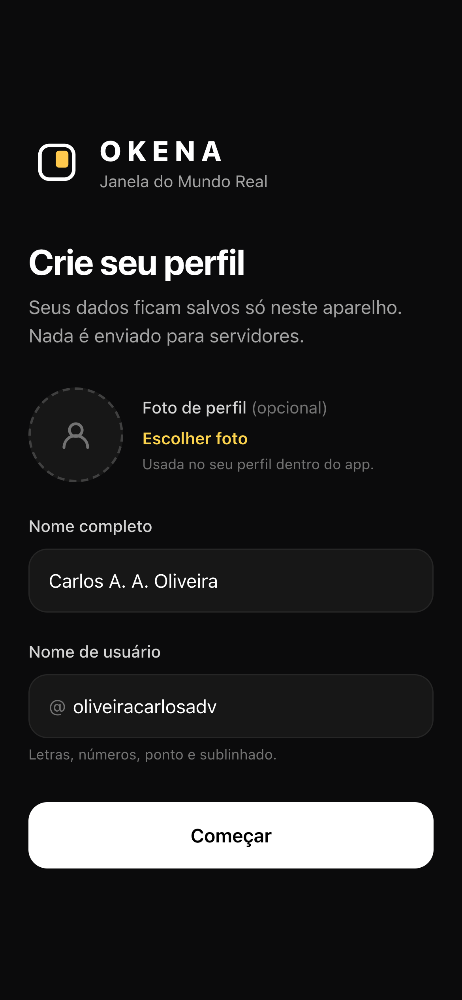
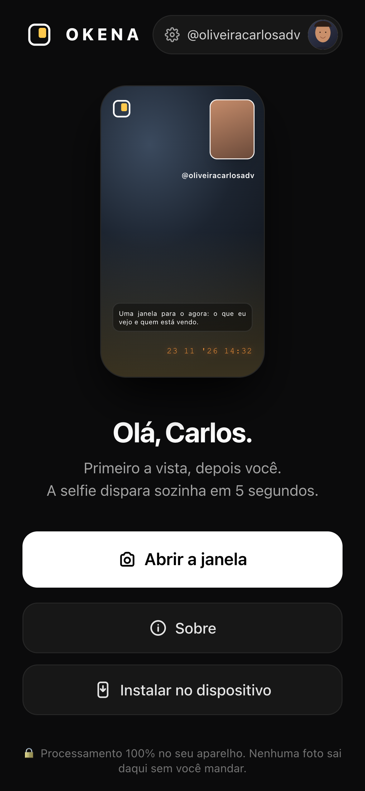
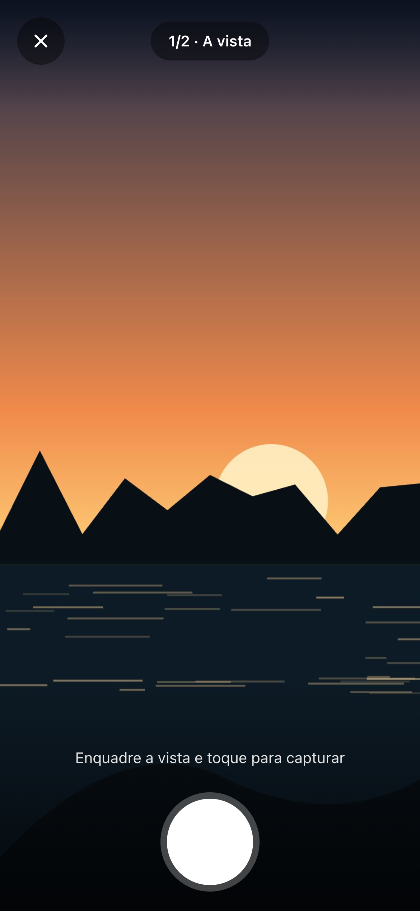
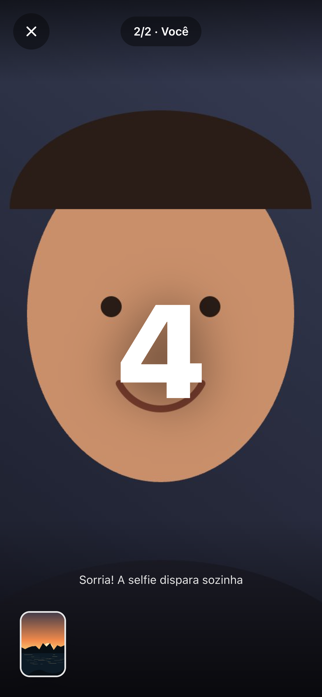
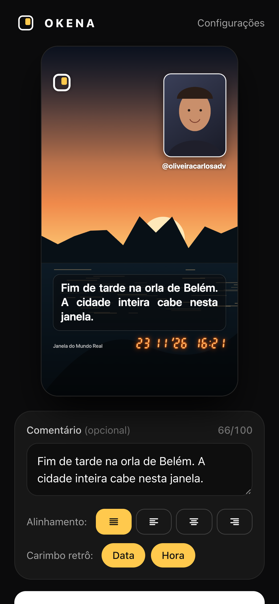
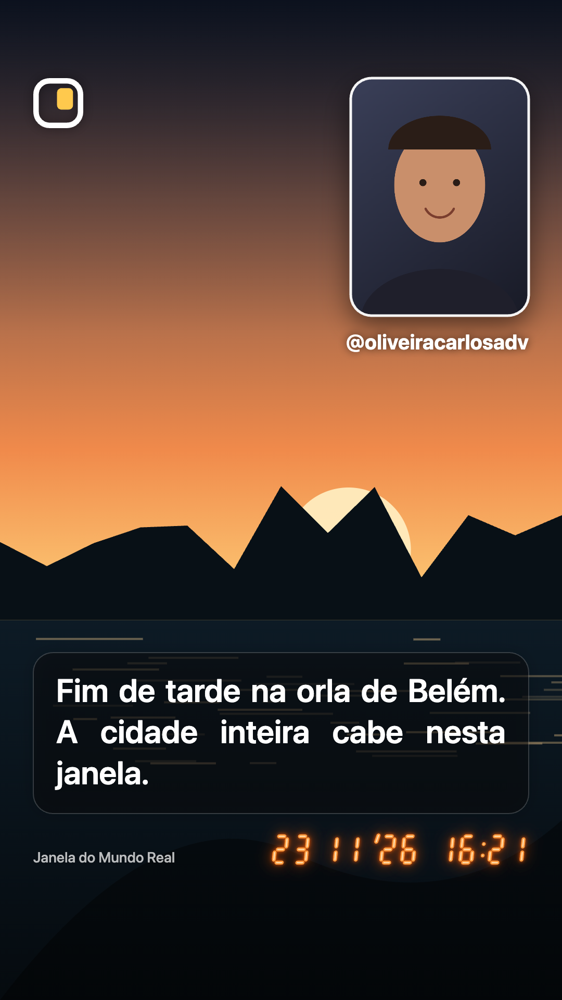
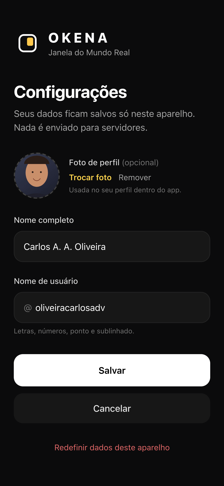
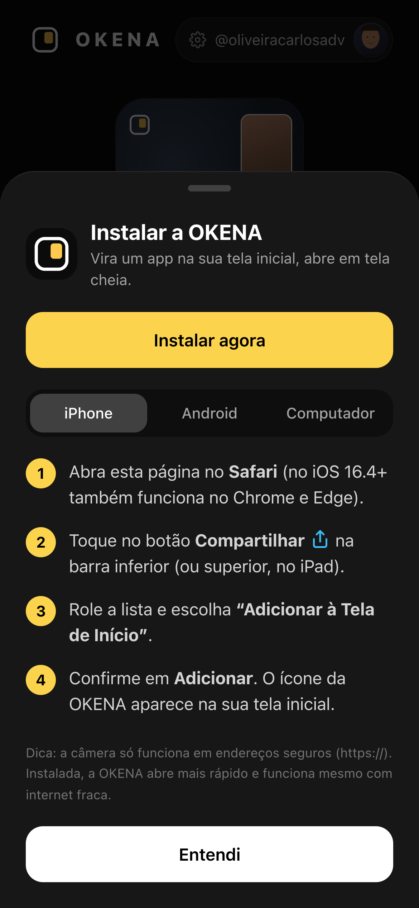
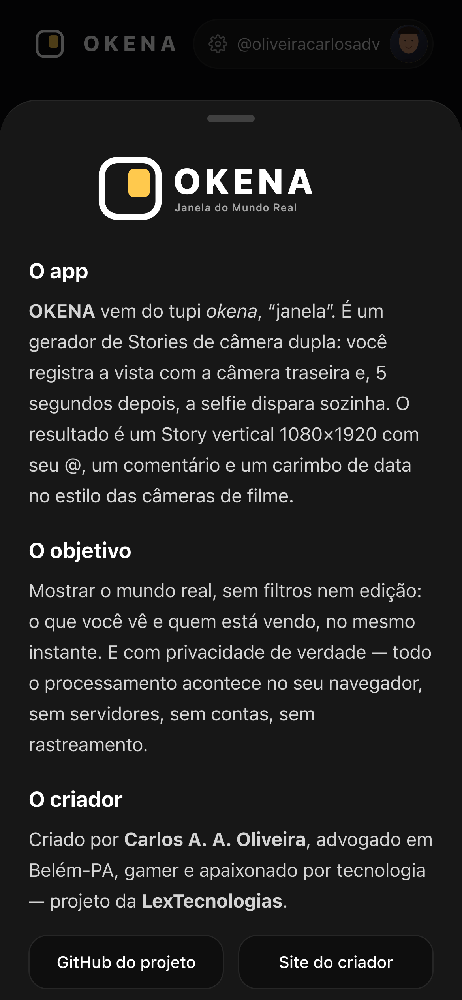

# Manual de uso — OKENA

> **Janela do Mundo Real.** A vista e a sua selfie, no mesmo instante.

Acesse: **https://oliveiracarlosadv.github.io/okena/**

---

## Sumário

1. [Antes de começar](#1-antes-de-começar)
2. [Primeiro acesso: criar o perfil](#2-primeiro-acesso-criar-o-perfil)
3. [Tela inicial](#3-tela-inicial)
4. [Capturar: a vista](#4-capturar-a-vista)
5. [Capturar: a selfie em 5 segundos](#5-capturar-a-selfie-em-5-segundos)
6. [Pré-visualizar e personalizar o Story](#6-pré-visualizar-e-personalizar-o-story)
7. [Compartilhar, baixar ou tirar outra](#7-compartilhar-baixar-ou-tirar-outra)
8. [Configurações do perfil](#8-configurações-do-perfil)
9. [Instalar no dispositivo](#9-instalar-no-dispositivo)
10. [Sobre](#10-sobre)
11. [Solução de problemas](#11-solução-de-problemas)
12. [Perguntas frequentes](#12-perguntas-frequentes)

---

## 1. Antes de começar

- **Aparelho:** qualquer celular com câmera traseira e frontal. No computador a OKENA funciona com a webcam
  (a mesma câmera é usada nas duas etapas).
- **Navegador:** Safari (iOS 15+), Chrome, Edge, Samsung Internet ou Firefox, em versões recentes.
- **Conexão segura:** a câmera só é liberada em endereços `https://`. O link oficial já é seguro.
- **Privacidade:** nada é enviado para servidores. Veja a [política de privacidade](PRIVACIDADE.md).

## 2. Primeiro acesso: criar o perfil

Na primeira vez, a OKENA pede três informações:

| Campo | Obrigatório | Para que serve |
|---|---|---|
| **Foto de perfil** | Não | Identifica você dentro do app (tela inicial e configurações). Não vai para o Story. É recortada em quadrado automaticamente. |
| **Nome completo** | Sim | Usado na saudação da tela inicial. |
| **Nome de usuário** | Sim | Seu @. Aceita letras, números, ponto e sublinhado (até 30). Não precisa digitar o “@”. |

Toque em **Começar**. Os dados ficam salvos **só neste aparelho e neste navegador** (no `localStorage`), então
você não precisa preencher de novo.

 

## 3. Tela inicial

- **⚙️ @usuario (canto superior direito):** abre as **Configurações** do perfil.
- **Maquete do Story:** mostra como o resultado fica organizado.
- **Abrir a janela:** começa a captura.
- **Sobre:** o que é a OKENA, o objetivo e quem criou.
- **Instalar no dispositivo:** guia para instalar a OKENA como app.

 

## 4. Capturar: a vista

1. Toque em **Abrir a janela**.
2. Na primeira vez, o navegador pergunta se a OKENA pode usar a câmera. Toque em **Permitir**.
3. A **câmera traseira** abre em tela cheia. O selo **1/2 · A vista** confirma a etapa.
4. Enquadre o que você está vendo e toque no **botão branco** central.

Dicas:

- Segure o celular **na vertical**; o Story é 9:16.
- O **✕** no canto superior esquerdo cancela e volta ao início.
- No computador, a barra de espaço ou Enter também captura.

 

## 5. Capturar: a selfie em 5 segundos

Logo depois da vista, a OKENA:

1. alterna sozinha para a **câmera frontal** (selo **2/2 · Você**);
2. mostra uma contagem grande na tela: **5… 4… 3… 2… 1…**;
3. dispara a selfie **automaticamente** no fim da contagem.

A miniatura no canto inferior esquerdo é a foto da vista que você acabou de tirar. A selfie sai espelhada, igual
ao que você vê na tela.

> Se você sair do app (trocar de aba, bloquear a tela) durante a captura, ela é interrompida por segurança e
> você volta ao início.

 

## 6. Pré-visualizar e personalizar o Story

O Story aparece pronto. Abaixo dele você personaliza, e a imagem é atualizada na hora:

**Comentário (opcional, até 100 caracteres)**
O contador mostra quantos caracteres você usou. A fonte é **adaptativa**: textos curtos saem grandes; textos
longos diminuem para caber em até cerca de quatro linhas.

**Alinhamento**

| Ícone | Opção | Resultado |
|---|---|---|
| ☰ | Justificado | Linhas ocupam toda a largura (a última fica à esquerda). Padrão. |
| ⯇ | Esquerda | Texto alinhado à margem esquerda. |
| ≡ | Centralizado | Cada linha centralizada na caixa. |
| ⯈ | Direita | Texto alinhado à margem direita. |

**Carimbo retrô**
Ligue ou desligue **Data** e **Hora**. Elas aparecem no canto inferior direito, em laranja, no estilo do
carimbo das câmeras de filme (ex.: `23 11 '26  14:32`). Com os dois desligados, o carimbo some.

A OKENA lembra o alinhamento e o carimbo que você escolheu para os próximos Stories.

 

### Como o Story é montado

| Elemento | Posição |
|---|---|
| Foto da vista | Fundo inteiro, em modo “preencher” |
| Ícone da OKENA | Canto superior esquerdo |
| Selfie 3:4 | Canto superior direito, cantos arredondados, borda branca e sombra |
| Seu @ | Logo abaixo da selfie, alinhado à direita dela |
| Comentário | Caixa translúcida na parte de baixo |
| Data / hora | Canto inferior direito, estilo LED retrô |
| “Janela do Mundo Real” | Canto inferior esquerdo, discreto |

Os elementos ficam afastados das bordas de cima e de baixo para não ficarem escondidos pela barra do Instagram.

 

## 7. Compartilhar, baixar ou tirar outra

- **Compartilhar:** abre a folha de compartilhamento do sistema com o PNG. Escolha **Instagram** (Stories),
  **WhatsApp**, **Salvar imagem** / **Fotos** etc. Se o navegador não suportar compartilhar arquivos, a OKENA
  baixa a imagem automaticamente.
- **Baixar:** salva `okena-usuario-AAAAMMDD-HHMM.png` (1080 × 1920).
  No iPhone, o arquivo vai para **Arquivos › Downloads**; para mandar à galeria, use **Compartilhar › Salvar Imagem**.
- **Tirar outra:** recomeça pela câmera traseira.

## 8. Configurações do perfil

Acesse pela pílula **⚙️ @usuario** na tela inicial ou pelo link **Configurações** na pré-visualização.

- **Trocar foto / Remover:** escolhe outra foto de perfil (galeria ou câmera) ou retira a atual.
- **Nome completo** e **Nome de usuário:** edite e toque em **Salvar**. Se você veio da pré-visualização, o
  Story é refeito com os dados novos.
- **Redefinir dados deste aparelho:** apaga nome, @ e foto salvos e volta ao cadastro inicial.

 

## 9. Instalar no dispositivo

Toque em **Instalar no dispositivo** na tela inicial. O guia abre já na aba do seu aparelho.

**iPhone / iPad (Safari)**
1. Toque em **Compartilhar** (quadrado com seta para cima).
2. Escolha **Adicionar à Tela de Início**.
3. Toque em **Adicionar**.

**Android (Chrome)**
1. Toque no menu **⋮**.
2. Escolha **Instalar app** (ou **Adicionar à tela inicial**).
3. Confirme em **Instalar**.

**Computador**
- Chrome/Edge: ícone de instalar na barra de endereço, ou menu **⋮ › Transmitir, salvar e compartilhar › Instalar página como app**.
- Safari no macOS: **Arquivo › Adicionar ao Dock**.

Quando o navegador permite, aparece também o botão **Instalar agora**, que instala com um toque.
Se a OKENA já estiver aberta como app, o guia avisa.

 

## 10. Sobre

O botão **Sobre** mostra o significado do nome, o objetivo do projeto, quem o criou, os links do código
e a versão instalada.

 

## 11. Solução de problemas

| Mensagem / sintoma | O que fazer |
|---|---|
| **Permissão negada** | Toque no cadeado (ou “aA” no Safari) na barra de endereço e permita a câmera. No iPhone: **Ajustes › Safari › Câmera › Permitir** (ou Perguntar). Depois toque em **Tentar novamente**. |
| **Câmera ocupada** | Feche outros apps ou abas que usam a câmera (chamadas de vídeo, outro app de câmera) e tente de novo. |
| **Nenhuma câmera encontrada** | O aparelho não tem câmera disponível ou ela está desativada. |
| **Conexão não segura** | Abra pelo endereço `https://oliveiracarlosadv.github.io/okena/`. |
| **A câmera não respondeu** | Tente de novo; se persistir, recarregue a página. |
| A selfie usou a câmera traseira | Alguns aparelhos/navegadores não permitem escolher a câmera; atualize o navegador ou use o Safari/Chrome. |
| “Compartilhar” só baixou o arquivo | Seu navegador não suporta compartilhar arquivos. Abra o PNG baixado e compartilhe pela galeria. |
| O Instagram não aparece na lista | Atualize o Instagram e, no iPhone, role a primeira linha de apps até “Mais” para ativá-lo. |
| Perdi meu perfil | Os dados ficam no navegador; limpar dados de navegação ou usar aba anônima apaga o perfil. É só cadastrar de novo. |

## 12. Perguntas frequentes

**As minhas fotos vão para algum servidor?**
Não. A OKENA não tem servidor. Tudo é processado no seu aparelho. A foto só sai dele se você compartilhar.

**Preciso criar conta?**
Não. Não há login, e-mail nem senha.

**É grátis?**
Sim, e o código é aberto (licença MIT).

**Funciona sem internet?**
Depois da primeira visita (ou instalada como app), sim.

**Posso trocar a ordem e tirar a selfie primeiro?**
Não. A proposta é sempre a mesma: primeiro o mundo, depois você.

**Por que “OKENA”?**
É “janela” em tupi. O app é uma janela para o seu mundo real, naquele instante.
